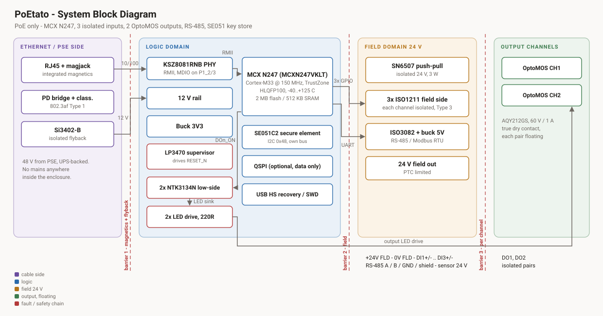
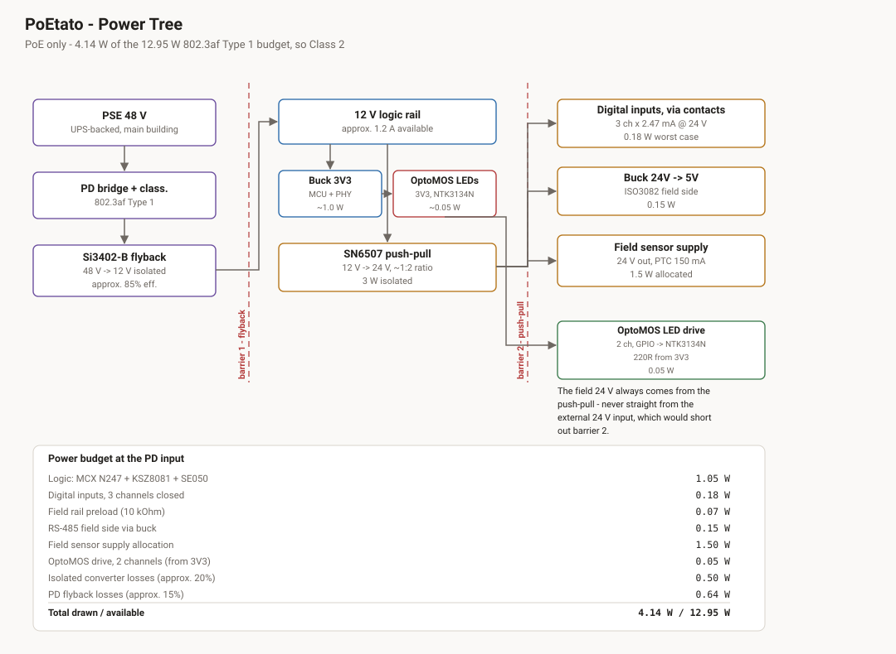
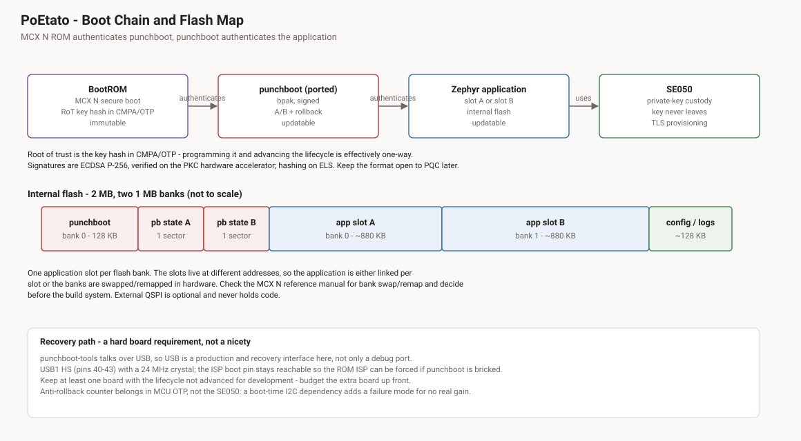
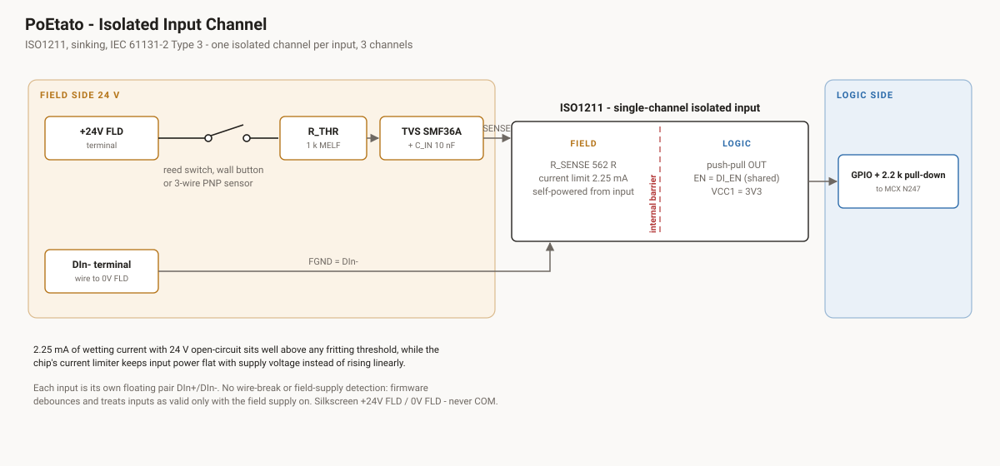
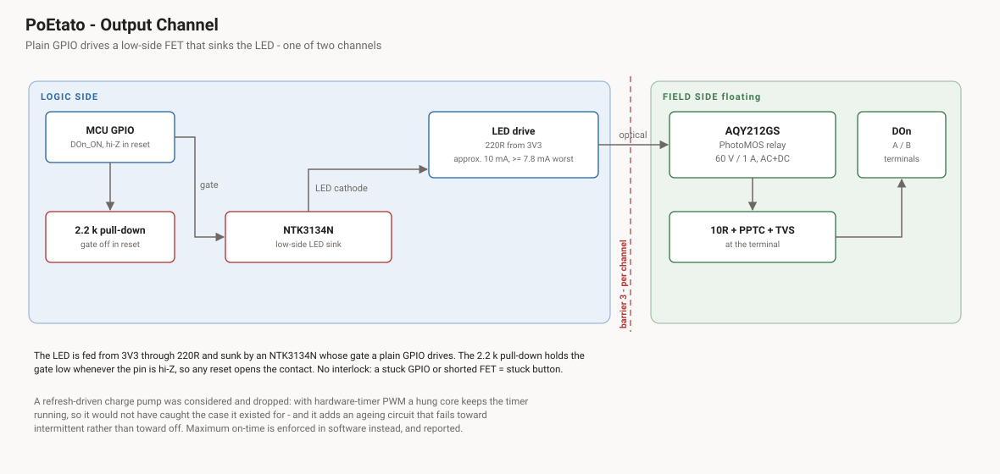
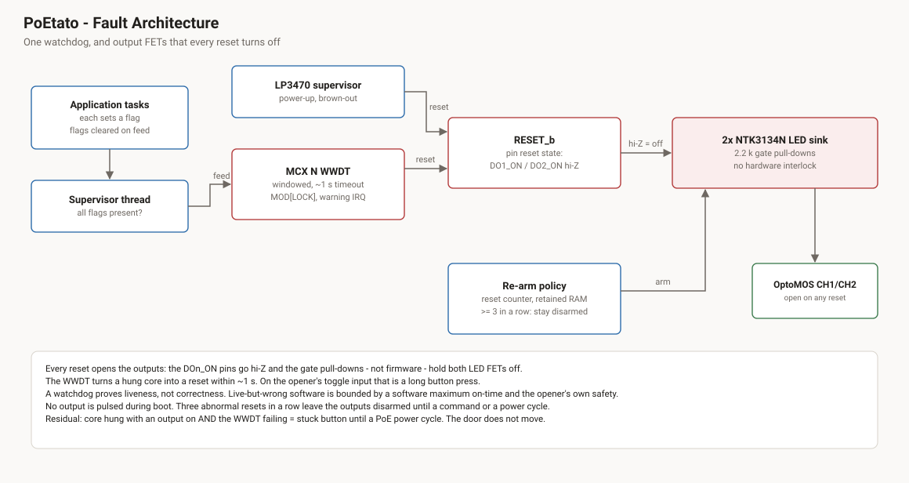

# PoEtato — Hardware Architecture

A PoE-powered, PLC-like controller for the garage. Monitors and controls a
Crawford/Normstahl **Magic 600** door operator, reads environmental sensors, and
integrates with Home Assistant over Ethernet.

Primarily an educational project: the point is to build a real industrial-grade
I/O device, not the cheapest thing that opens a garage door.

| | |
|---|---|
| **MCU** | NXP MCX N247 (MCXN247VKLT), Cortex-M33 + TrustZone, HLQFP100 |
| **Link** | 10/100 Ethernet, powered over the same cable (802.3af Type 1) |
| **Power** | PoE only, 802.3af Type 1, Class 2 |
| **I/O** | 3 isolated digital inputs, 2 OptoMOS outputs, 1 isolated RS-485 port |
| **Field supply** | 24 V isolated, 3 W |
| **Security** | MCX N ROM secure boot → punchboot + NXP EdgeLock SE051, I²C |
| **Firmware** | Zephyr — Modbus TCP server, Modbus RTU master, MQTT |
| **Enclosure** | Italtronic 35.0807000.BL, 8M DIN |

---

## 1. Design principles

**No mains inside the enclosure.** PoE delivers power over a cable that is
already galvanically isolated by the Ethernet magnetics and already UPS-backed
from the main building. There is no 230 V creepage to design for, no fused mains
entry, no Y-caps across a mains barrier. Every mains-switching load stays
external.

**Fail-safe by removing itself.** This box is a convenience actuator, not a
safety system. The real safety functions — obstruction detection, force
limiting, the photocell — live in the door operator, are certified, and are
entirely independent of anything here. The only safety requirement on this
design is that when it misbehaves it *disappears cleanly* and leaves the door
exactly as it was.

**Strictly parallel to the existing controls.** The wall button and the handheld
remote are never interrupted by this device. A fault here can therefore never
mask a fault in the door.

**Every measurement carries a validity flag.** Borrowed from PLC practice: a
number without a status is a bug waiting to happen. Over/under range, the
field-supply state and the commanded output state are all exposed
alongside the data.

**Isolation that is real, not decorative.** Each barrier has a floating supply
behind it. An isolator whose two sides share a ground is a part you paid for and
then shorted out.

---

## 2. System overview



Isolation domains:

| Domain | Contents | Referenced to |
|---|---|---|
| **Cable / PSE side** | RJ45, magjack centre taps, PD bridge, Si3402-B primary | the Ethernet cable |
| **Logic** | MCX N247, PHY, SE051, supervisor, output LED drive, QSPI flash | board logic ground |
| **Field 24 V** | RS-485 transceiver field side, 5 V buck, field supply `+24V FLD` | field 0 V |
| **Input channels** | 3 × ISO1211 field side, each pair floating independently | its own `DIn−` |
| **Output channels** | 2 × AQY212GS, each pair floating independently | nothing — true dry contacts |

Ethernet *data* crosses barrier 1 through the magjack's magnetics; Ethernet
*power* crosses it through the PD flyback. The field domain sits behind barrier
2, fed by an isolated push-pull converter. Each input channel is its own
floating pair behind its own ISO1211, and each output channel is its own
floating pair behind its own PhotoMOS.

---

## 3. Power



### Topology

```
PSE 48 V (UPS-backed)
  └─ PD bridge + classification (802.3af Type 1, Class 2)
      └─ Si3402-B isolated flyback ──╫── 12 V logic rail
                                          ├─ buck 3V3 ...... MCU, PHY, flash, SE051,
                                          │                  OptoMOS LEDs (low-side FET per channel),
                                          │                  VDD_BAT via supercap backup
                                          └─ SN6507 push-pull ──╫── 24 V field, 3 W
                                                                    ├─ digital inputs (via contacts, 2.25 mA each)
                                                                    ├─ buck 5V → ISO3082
                                                                    └─ TPS26625 eFuse (66 mA) → `+24V FLD` terminal
```

**The 12 V secondary is a deliberate choice.** It makes the field converter a
1:2 push-pull rather than the 1:5 ratio a 5 V secondary would force — better
regulation, less leakage inductance — while the logic buck to 3V3 is trivial
either way.

**The driver is the SN6507, not the SN6505B** (changed 2026-10-03). The SN6505
is a 2.25–5.5 V part (6 V absolute maximum) and cannot run from the 12 V rail;
a push-pull from 12 V also puts 2 × V_IN ≈ 24 V plus ringing on the switch
nodes. The SN6507 takes 3–36 V, has 0.5 A switches (3 W needs ≈ 0.3 A on the
primary), programmable frequency (100 kHz–2 MHz), soft-start, current limit
and spread spectrum, in HVSSOP-10 with thermal pad.

### Field supply enable

Decided 2026-10-06. The 24 V field supply is **switched by firmware**:
`P24V_FIELD_EN` (P3_16) drives the SN6507 EN/UVLO pin, with a 2.2 kΩ
pull-down.

- **Off in reset and during boot.** While the pin is high-impedance the
  pull-down holds EN low, so the field rail is down through power-up, any reset
  and ROM/punchboot. Firmware turns it on once the application runs.
- **Everything on the field side goes with it:** `+24V FLD` on the terminals
  (sensor supply and the input contacts), and the RS-485 5 V buck with the
  ISO3082 bus side.
- **Consequences for firmware:**
  - Inputs are valid only while the field supply is enabled and has settled
    (§6).
  - RS-485 traffic starts only after the 5 V buck is up. Its EN divider holds it off until the field rail passes ≈ 13.5 V, then the internal 4 ms soft-start runs.
  - Report the enable state with the data.
- **Why it is switched.** Firmware can drop the field side deliberately: to
  recover from a field-wiring fault, to save power, or to keep field devices
  unpowered until the box is running. Its own reset state is "field off", like
  the outputs.

### Field output protection — TPS26625

Decided 2026-10-07. The `+24V FLD` terminal is fed through a TI **TPS26625**
eFuse (`P24V0_FIELD` → `P24V0_FIELD_PROT`), replacing the PTC that was planned
here. The RS-485 buck stays on the unprotected rail, so a short
on the terminal is limited to less than the rail can supply and RS-485 stays up.
The digital inputs are fed from the terminal (via the contacts) and go down with
it.

**Variant.** TPS26625: auto-retry, with input and output reverse-polarity
protection. Auto-retry because SHDN and FLT are on the field side where the MCU
cannot reach them; a latching part could only be reset by cycling
`P24V_FIELD_EN`. Output-side protection because a mis-wired external 24 V supply
on a screw terminal is the realistic fault. The part has no MODE pin (it appears
only in the datasheet's front-page figure); the fault response is set by the
part number.

| Part (datasheet name) | Value | Result |
|---|---|---|
| R_ILIM (ILIM → RTN) | 100 kΩ 1 % | 66 mA overload limit, ≈ 60–73 mA (I_OL = 6.636 / R_ILIM[kΩ]) |
| R1 (IN → UVLO) | 200 kΩ, 0603 thick film | |
| R2 (UVLO → RTN) | 14.0 kΩ | UVLO rising 18.3 V, falling 16.8 V; 112 µA divider current |
| OVP | tied to RTN | Disabled |
| C_dVdT (dVdT → RTN) | 1 µF X7R, ≥ 16 V | 49 V/s, 0.49 s ramp at 24 V |
| C_IN | 1 µF 100 V X7R at the pin | In addition to C72 (22 µF) on the rail |
| C_OUT | 1 µF 100 V X7R | |
| Output clamp | D24 `SMAJ28CA`, no Schottky | TI specifies a TVS, not a Schottky, for the TPS26624/25 |
| FLT | not connected | Nothing fitted (decided 2026-10-07): no LED, no pull-up |
| SHDN | open | Internal pull-up keeps the part enabled |
| RTN | own copper island, not tied to GND | Support parts and PowerPAD go to RTN |

**Current limit.** The binding limit is the SN6507's own current limit, not the
3 W transformer rating: with R72 = 75 kΩ it delivers ≈ 0.14 A typical and
≈ 92–106 mA minimum on the 24 V side. The eFuse at 66 mA (≈ 60–73 mA) plus
≈ 10–15 mA for RS-485 and the UVLO dividers stays below that, so a short on
the terminal never drags the field rail into the converter's limit and RS-485
stays up. Rate the terminal at **50 mA continuous** (1.2 W, inside the 1.5 W
sensor allocation of the budget); that includes the 7.4 mA of the three inputs.
The datasheet gives ±5 % at 152 mA and −20/+28 % at 25 mA; roughly ±10 % at
66 mA is interpolated, not specified.

**UVLO divider.** 200 kΩ rather than the usual 1 MΩ, for the humid garage:
surface leakage across R1 sits in parallel with it, and 10 MΩ of leakage moves
the threshold ≈ 2 % here against ≈ 9 % with 1 MΩ. TI's "at least 1 MΩ" applies
only when UVLO is tied straight to IN; with the divider the pin stays below 2 V
at a 30 V rail (4 V recommended maximum). Thick film, not nichrome thin film.

**OVP is disabled.** The rail is the board's own, and an OVP trip at light load
would remove the rail's last load and push it higher. Option if the bench shows
a need: R2 = 6.19 kΩ, R3 = 7.87 kΩ (OVP pin at their junction) gives cut-off at
32.6 V, return at 30.5 V, with the same UVLO.

**Ramp, sized for 1000 µF on the terminal.** Inrush is C × dV/dt: 49 mA typical
into 1000 µF, ≈ 78 mA worst case (+20 % capacitor, charging current and gain at
their limits). The worst case can exceed the ≈ 60 mA minimum limit; the eFuse
then finishes the charge in current limit (1000 µF to 24 V at 60 mA ≈ 0.4 s,
well inside the ≈ 2.2 s timer) and carries on. Load drawn during the ramp comes
out of the same current. Dissipation during the ramp ≈ 0.6 W for half a second.

Consequences of the slow ramp:

- **Firmware settle time.** The terminal takes 0.5 s typical, ≈ 0.7 s worst
  case, to come up after `P24V_FIELD_EN`. Wait **at least 1 s** before marking
  the inputs valid.
- **A dead short runs hotter.** The current-limit timer scales with C_dVdT:
  512 ms + 3.3 × C_dVdT[nF] / 2 ≈ 2.2 s, then a 512 ms retry. At 24 V × 66 mA ≈
  1.6 W and 44.8 K/W (datasheet p.6) the junction rises ≈ 72 K, ≈ 127 °C at
  55 °C ambient, below thermal shutdown (155 °C), so the part cycles on the
  timer. 470 nF would halve the timer and still charge 1000 µF, partly
  in current limit.
- **The dVdT node is humidity-sensitive.** It charges with 2 µA to ≈ 4.3 V:
  10 MΩ of surface leakage slows the ramp ≈ 20 %, ≈ 2 MΩ stalls it. Keep the
  node short, clean and under the conformal coat.

**No fault indication.** With FLT unused, a tripped eFuse is not reported
anywhere; it looks like "all inputs open", the same as a dead field supply
(§10).

**Negative surge on the output.** The TPS26625 output is rated to −(60 − V_IN),
≈ −34 V. The SMAJ28CA starts conducting at 31–34 V and clamps at 45 V at full
pulse current: a −24 V mis-wire is fine, a hard negative surge is marginal.

### Field rail regulation

The 24 V field rail is **unregulated**. A push-pull driver runs open loop:
output = V_IN × turns ratio − resistive and diode drops. Expect (estimates,
to be confirmed on the bench):

| Condition | Behaviour |
|---|---|
| Line | Tracks the 12 V rail percent for percent at fixed duty. The SN6507's duty-cycle feed-forward (DC pin) can remove this, but needs an output inductor — see open items |
| Load, 10–100 % | Roughly linear droop, 5–10 %. ≈ 1.2–1.5 V lost at 125 mA (switch R_DS(on) and primary copper reflected ×2, one Schottky drop, secondary copper, leakage) |
| Load below ~5–10 % | Output rises sharply (rectifier peak-charges on leakage ringing); 20–30 % above nominal is typical for the topology |
| Temperature | Slightly more droop hot |

- **No preload** (decided 2026-10-08; the 10 kΩ R8 was removed). The digital
  inputs only load the rail while a contact is closed, and the only permanent
  load is the two UVLO dividers and the LMR51420 quiescent current (≈ 0.15 mA).
  With nothing connected the rail therefore sits at the rectified peak,
  ≈ 27–28 V, more if switching spikes peak-charge it. Every part on the rail is
  rated well above that (LMR51420 36 V, TPS26625 60 V, capacitors 50 V); the
  open-circuit terminal voltage has to stay ≤ 30 V, which is a bench item.
- Expected span: ≈ 25–26 V with the sensor output unloaded, ≈ 22.5–23.5 V at
  the full 3 W. Inside the IEC 61131-2 window (19.2–30 V), so **no
  post-regulator**.
- Turns ratio: choose for ≈ 23–24 V at full load rather than an exact 1:2.
  Candidate: Würth `750319693` (1:2.29, used by TI for 12 → 24 V with the
  SN6507).
- Settled in the schematic: fixed duty (DC pin open, 48 %), CLK to GND
  (1 MHz default), R_ILIM 75 kΩ (≈ 0.32 A typ. primary), C_SS 4.7 µF (≈ 18 ms),
  RC snubbers 100 Ω + 68 pF on both rectifier anodes, L5 3.3 µH choke-input
  filter.
- Bench: measure the rail with no load (open terminal, RS-485 idle, 57 V PoE).
  If the terminal exceeds 30 V, add a Zener clamp or bring back a small preload.

### Budget

802.3af Type 1 gives 12.95 W at the PD. Allocated:

| Item | Power |
|---|---|
| Logic: MCX N247 + KSZ8081 + SE051 + QSPI flash | 1.05 W — conservative; MCU itself ~20 mA @150 MHz |
| Digital inputs, 3 channels closed (3 × 2.47 mA max × 24 V) | 0.18 W |
| RS-485 field side via buck | 0.15 W |
| Field sensor supply allocation | 1.50 W |
| OptoMOS drive, 2 channels (from 3V3) | 0.05 W |
| Isolated converter losses (~20 %) | 0.50 W |
| PD flyback losses (~15 %) | 0.64 W |
| **Total** | **4.07 W of 12.95 W** (2.42 W below the Class 2 limit of 6.49 W) |

**This drops the PD a classification.** At 7.3 W the board was Class 3
(6.49–12.95 W); at 4.07 W it is **Class 2** (3.84–6.49 W). Set the
classification resistor accordingly — it is politer to the switch's power
budget, and a switch with a constrained budget will thank you for it.

Heavy 24 V loads — solenoids, relay modules, anything measured in amps — get
their own supply. That is a documented limit of this design, not an oversight.

### RTC and retained-RAM backup — `VDD_BAT`

```
3V3 ──BAS70──┬── VDD_BAT (1 µF at pin)
             └── 220 Ω ── KW-5R5C334H-R, 0.33 F ── GND
```

Decided 2026-10-01: **Eaton `KW-5R5C334H-R`** supercap, no coin cell.

- **Purpose.** The RTC (32.768 kHz crystal, C_L ≤ 7 pF) and 8 KB VBAT SRAM
  survive a PoE outage. Certificate validation then has a sane clock at boot,
  and boot-time security events get wall-clock timestamps. Loss is handled in
  firmware (time state UNKNOWN, floor time), so the backup is a convenience,
  not a dependency.
- **Requirement: ≥ 8 h worst case (end of life, 40 °C), ≥ 24 h typical.** Behind
  the UPS, typical grid outages (~1 h; Ei 2024: SAIFI 1.0, SAIDI 63 min) never
  reach the board. What remains is switch/UPS maintenance (hours) and outages
  longer than the UPS runtime, where losing time is harmless because the
  network and NTP come back with the power.
- **Supercap over coin cell.** No replacement, no Battery Regulation question,
  and it rides through the 10–17 K enclosure rise.
- **Part.** 0.33 F −20/+80 %, 5.5 V rated (runs at ~57 %), −40…+85 °C, 2000 h at
  85 °C / 5.5 V, Ø13.5 × 8.8 mm, horizontal THT, hand or wave solder only.
- **Holdup.** Load is ~0.9 µA at 25 °C and ~1.3 µA at 40 °C (DS Table 23, RTC on
  OSC32K + 8 KB SRAM). Worst case ≈ 14 h: 0.185 F at end of life, 2.95 → 1.71 V,
  2× load, an assumed 5 µA leakage (the datasheet gives none). Typical ≈ 43 h.
  The RTC crystal, Epson FC-135R `X1A0001410006` (C_L 6 pF, ESR ≤ 50 kΩ), meets the
  low-power-mode limits of the 32 kHz oscillator (DS Table 36: C_L ≤ 7 pF,
  ESR ≤ 50 kΩ), so it can run in low-power mode (110 vs 220 typ., presumably nA).
  The holdup figures above already allow for normal mode. Measure the
  oscillator margin on the board: C_L 6 pF needs ≈ 24 pF summed over both pins,
  against 22 pF for Coarse_Amp_Gain 01 (DS Table 37).
  Cold garage temperatures reduce both load and leakage. A 1 F part was only
  needed for a 24 h worst-case target.
- **Circuit.**
  - One diode. The cap feeds `VDD_BAT` through R with no drop, so usable swing
    is ≈ 1.4 V (3.15 → 1.71 V).
  - BAS70-class Schottky for low reverse leakage, which only matters in an
    outage, at ambient temperature.
  - On a cold start with an empty cap, `VDD_BAT` ramps together with 3V3, one
    BAS70 drop lower (≈ 0.7 V at the ≈ 6–12 mA charging current). The rule
    "VDD_BAT must ramp before or with VDD_SYS" (DS p.14, UG10092 §3) sets an
    order, not a voltage match, so this is accepted (review W2-1, 2026-10-12).
    `VDD_BAT` is below its 1.71 V minimum only while 3V3 is ≈ 1.9–2.4 V, with
    `RESET_b` held. Measured at bring-up (verification-plan §5.2); if boot
    problems appear, raise the 220 Ω to 2.2 kΩ (≈ 1.2 mA, ≈ 0.4 V drop).
  - 220 Ω limits inrush to ~11 mA (22 Ω would draw ~100 mA for tens of seconds).
- **Port 5 runs at `VDD_BAT` (~3.1 V).** No 3V3 logic may drive P5 pins.
- **Firmware.** Magic word + CRC on retained data. On a CRC failure treat RAM and
  RTC as lost: between 1.71 V and VBAT POR the domain is out of spec but not
  reset.
- **Bring-up test.** After ≥ 24 h powered, remove PoE for 24 h, then check the CRC
  and RTC against NTP.

### Notes

- **Bench power header J6** (decided 2026-10-06): a 2-pin 2.54 mm header
  (Würth 61300211121, not a field terminal) directly on `P12V0`, pin 1 GND and
  pin 2 +12 V, so a lab supply can drive the board on the desk without a PoE
  injector.
  - **No series diode.** The flyback's output rectifier D4 (PDS5100Q) is
    reverse-biased by the bench supply, so nothing backfeeds into the
    transformer. Through R28 (0 Ω) the bench supply also powers the flyback's
    secondary feedback (TLVH431 and opto LED), which is harmless: with PoE
    absent the primary is off, and with PoE present the loop simply idles the
    flyback (verification-plan §6.9).
  - **No reverse-polarity protection.** The header is unkeyed. A reversed
    supply forward-biases D4 through the transformer secondary and puts −12 V
    on every 12 V load. Use a current-limited lab supply and a keyed or marked
    cable.
- Input wetting current is the third-largest item on the board. If it ever
  becomes awkward, **pulsed wetting** — gating the field rail at low duty and
  sampling synchronously — cuts average power by the duty factor while keeping
  peak current high enough to clear contact films. Not needed at this budget.

---

## 4. Compute and comms

### MCU — MCX N247

**MCXN247VKLT**: HLQFP100 (14 × 14 mm, 0.5 mm pitch, exposed pad), single
150 MHz Cortex-M33 with TrustZone, 2 MB dual-bank internal flash, 512 KB SRAM
(32 KB of it with ECC), −40…+125 °C. In mass production.

Decided 2026-09-29, replacing the i.MX RT1021. The full comparison, including the
rejected candidates, is in `doc/security-requirements.md` §6.

Selection rationale:

- **Security hardware is the point.** EdgeLock Secure Enclave (Core Profile):
  - ELS (AES, SHA, key store)
  - PKC public-key accelerator
  - PUF
  - TRNG
  - ROM secure boot, debug authentication, OTP monotonic counters
  - tamper and glitch detectors

  It is the same die as the MCX N94x/N54x, which are PSA Certified Level 3.
- **Internal dual-bank flash.** Firmware no longer executes in plaintext from an
  external QSPI a SOIC clip can read, and the A/B slots map onto the two banks.
- **RMII Ethernet *and* High-Speed USB with an on-chip PHY in a 100-pin QFP.** The
  N947 in the same package has only full-speed USB, because its pins 40–43 are GPIO.
- **Single core is right-sized.** The N94x's second core, NPU and PowerQuad would
  sit unused.
- **Still a hand-reworkable package.**

Things to get right:

1. **Not PSA certified yet.** The certificate covers N94x/N54x (A1) and N23x.
   This is an accepted risk for a hobby project. **MCXN547VKLT** is the
   pin-compatible certified fallback: its Ethernet and USB1 pins are identical.
2. **No upstream Zephyr SoC yet.** Add an MCXN247 variant modelled on the
   MCXN547 one: single core, no NPU/PowerQuad/USB FS, plus HLQFP100 pinctrl.
   Develop on the FRDM-MCXN947 (same die) in the meantime.
3. **Order VKLT, not VNLT** (VNLT was replaced, PCN 202502004F01). Choose the
   LDO or DCDC core-supply configuration per UG10092 §3.2.
4. **24 MHz crystal.** HS USB needs one of a fixed list of frequencies, and the
   ROM's USB ISP mode needs 24 MHz with factory fuses. Part (2026-10-08):
   Epson TSX-3225 `X1E0000210048`, −40…+105 °C, ±10 ppm + ±10 ppm over temperature,
   C_L 9 pF, ESR 40 Ω, drive ≤ 200 µW (distributor data; the Epson family
   sheet does not decode the ordering code). Load caps C1/C2 = 10 pF. Its ppm
   budget is set by the RMII reference (see the PHY section).

### Ethernet PHY — KSZ8081RNB

Originally chosen because it is the PHY on the MIMXRT1020-EVK. It remains a
well-trodden RMII PHY with Zephyr support. On MCX N, HLQFP100 supports **RMII
only** (the MII-only signals are not bonded), which is what we want anyway.

**MDC/MDIO must go on P1_2 / P1_3.** The FRDM-MCXN947 uses P1_20/P1_21, which
do not exist in HLQFP100. The RMII data pins are:

- TX_CLK/REF_CLK: P1_4
- TXEN: P1_5
- TXD0/1: P1_6/P1_7
- RXDV: P1_13
- RXD0/1: P1_14/P1_15

**RMII clocking: 50 MHz from the MCU, PHY in 50 MHz mode (firmware requirement).**
The MCU generates the 50 MHz RMII reference clock and outputs it on P1_4
(ENET0_TX_CLK). This needs P1_4 muxed to ENET0_TX_CLK and ENETRMIICLKSEL set to
a valid source, derived from the 24 MHz crystal (MCX N RM §33.3.30). The clock
goes through a 33 Ω series resistor into the PHY's XI pin. The PHY's REF_CLK
pin (19) and XO are left open.

The KSZ8081RNB **powers up in RMII 25 MHz clock mode** (crystal on XI/XO,
REF_CLK output). The "B" suffix means "REF_CLK output (power-up default)"; see
DS00002202D p.20 §3.3.1–3.3.2 and p.66. Firmware must therefore switch it to
50 MHz mode **after every PHY hardware reset**:

1. Assert `ETH_RST_N` (P1_1) low for ≥ 500 µs. The pin has a 10 kΩ pull-down,
   so the PHY stays in reset until firmware releases it.
2. Release reset and wait ≥ 100 µs before the first MDIO access (DS p.54).
3. Write Register 1Fh bit 7 = 1 (RMII 50 MHz clock mode, DS p.44) with a
   read-modify-write, so the LED mode and interrupt-level bits in 1Fh are kept.
4. Only then enable the ENET MAC and start auto-negotiation.

Notes:

- Repeat this after any PHY reset, including a software reset via Register 0h
  bit 15, a watchdog or brown-out reset, and recovery from link-loss handling.
- In Zephyr, check that the KSZ8081 PHY driver sets 1Fh.7 for this
  configuration (e.g. via its RMII 50 MHz devicetree option). Otherwise add it
  in board init.
- The 50 MHz reference must be within ±50 ppm (DS Table 7-12 p.57). It is
  derived from the 24 MHz crystal, so the crystal tolerance plus load-cap
  pulling must fit that budget. The crystal takes ±20 ppm of it (±10 ppm at
  25 °C + ±10 ppm over temperature), leaving ≈ ±30 ppm for pulling and aging.
  C1/C2 = 10 pF put the load at ≈ 8–10 pF against C_L = 9 pF (≈ ±20–40 ppm,
  depending on the board's stray capacitance), so measure the frequency on the
  first board and trim C1/C2 if needed. The MCX N oscillator itself targets
  ±40 ppm over life including aging (MCX N DS §4.2.1).
- The hardware alternative, if this ever becomes a problem: a 25 MHz crystal
  on XI/XO, PHY REF_CLK (pin 19) into P1_4 as an input. That removes the
  firmware step at the cost of a crystal.

### Boot — punchboot



**BootROM secure boot → punchboot → Zephyr application.**

- The MCX N ROM authenticates punchboot against the root-of-trust key hash
  provisioned in the device's protected configuration (CMPA/OTP).
- punchboot authenticates the application and manages the A/B slots and rollback.
- The SE051 then holds the private key the running application authenticates
  with.

**punchboot has to be ported to MCX N.** MCUboot is Zephyr-native and already
runs on MCX N. It may be used first to learn the MCX N boot flow and lifecycle,
but punchboot is the target. The port covers:

- **Platform layer:** clocks, internal dual-bank flash driver, the watchdog
  (enable the internal WWDT early and feed it through recovery; see §8), and
  the UUID3 identity derived from the MCX N unique ID.
- **Crypto:** signature verification on the **PKC** (hardware ECDSA) and hashing
  on **ELS**. Boot time no longer argues for a software-friendly algorithm.
- **Anti-rollback:** OTP/CFPA monotonic counters, kept in the MCU and not in the
  SE051. The rationale is unchanged; see §5.
- **USB recovery:** MCX N USB1 is NXP's EHCI high-speed controller, the same IP
  family as on i.MX RT, so punchboot's USB driver is likely largely reusable.
  Verify against the reference manual.

Board-level consequences, which are the parts that constrain the hardware:

**Flash layout.** Code lives in the internal 2 MB dual-bank flash, one
application slot per bank. Zephyr with the networking stack, mbedTLS and Modbus
realistically lands around 400–700 KB. Suggested layout:

| Partition | Location | Size |
|---|---|---|
| punchboot | bank 0 | 128 KB |
| punchboot state A / B | bank 0 | one erase sector each |
| Application slot A | bank 0 | ~880 KB |
| Application slot B | bank 1 | ~880 KB |
| Spare | bank 1 | remainder (~128 KB) |
| Filesystem: configuration, logs, data | external QSPI (`S25FL064L`, 8 MB) | 8 MB |

**External QSPI is fitted as standard** (decided 2026-10-06). It is an Infineon
`S25FL064L` (64 Mbit / 8 MB) on FlexSPI0 port A, and holds the filesystem: device
configuration, logs and data. **Never code.** If the image outgrows ~880 KB,
that is the signal to revisit, not to move code off-chip.

- **Nothing secret on the QSPI.** A SOIC clip can read it, so private keys and
  credentials stay in the SE051 (§5). Configuration that must not be tampered
  with is signed or MACed with a key the SE051 holds.
- **Recovery option.** Its pins (P3_0, P3_7, P3_8, P3_9) are also the ROM's
  SPI-flash recovery-boot pins (MCX N RM Table 227). A signed recovery image
  could live on it if punchboot recovery ever needs a fallback. Not planned.

**A/B addressing.** The two slots sit in different banks at different
addresses. **Check the MCX N reference manual for flash bank swap/remap.** If it
has none, link the application per slot (two link addresses). Decide this
before the build system is set up rather than after.

**Recovery is a hard board requirement.** punchboot-tools talks over USB, which
makes USB a production and recovery interface, not just a debug port:

- **USB1 (HS) wiring:**
  - pins 40/41 D+/D−
  - pin 42 USB1_VBUS straight to connector VBUS (the only 5 V-tolerant pin)
  - pin 43 VSS_USB to GND
  - VDD_USB at 3.3 V
  - The N247 has no FS controller, so USB0 pins 45/46 stay unconnected.
- The USB connector or header must be reachable without desoldering anything.
- The ISP boot pin must stay reachable, so the ROM ISP can be forced if
  punchboot is ever bricked.
- **USB1 HS is the only ROM ISP interface** (decided 2026-10-04). There is no
  UART ISP header. The ROM's default UART ISP pins (FC4, P1_8/P1_9) carry the
  RS-485 transceiver, and the board's debug UART on P0_20/P0_21 is not an ISP
  UART. The other way in is SWD (programming and debug, not ROM ISP).
- Set `ISP_BOOT_IF` in CMPA to USB1 slave ISP when provisioning. The default
  Auto ISP also probes UART, CAN, I²C and SPI on their ISP pins, including
  P1_8–P1_11 on the RS-485 transceiver (RM Tables 226/227).
- **Keep at least one board with the lifecycle not advanced** (secure boot not
  enforced, debug open) for development. Programming the CMPA and advancing the
  lifecycle is effectively one-way, so budget the extra board up front.

**Code confidentiality.** Code now lives in internal flash, which a SOIC clip
cannot read once debug is locked, so the old BEE question disappears. It
remains a weak requirement; the secret worth protecting is the key in the SE051.

### Known bring-up hazards

- **Pinmux differs from the dev board.** FRDM-MCXN947 is the VFBGA part:
  - MDIO is on P1_20/21 there and on P1_2/3 here.
  - USB1 is HS on both, but the N947 in HLQFP100 would not have it.

  Keep the board's pinctrl separate from the FRDM one from day one.
- **DMA and caches.** On i.MX RT the classic footgun was Ethernet DMA
  descriptors in cached memory: a stack that works for ten minutes and then
  corrupts. Check which MCX N caches (if any) sit in front of the SRAM used for
  ENET buffers before assuming it is gone.
- **Provisioning order.** Write the CMPA/lifecycle procedure down and rehearse it
  on the open board before touching a second one.

---

## 5. Secure element

**NXP EdgeLock SE051** (`SE051C2HQ1/Z01XDZ`), I²C, on a bus of its own.

| Parameter | Value |
|---|---|
| Supply | 1.62–3.6 V — **3.3 V** here |
| Interface | I²C, T=1 over I²C, default address **0x48** |
| Speed | up to 1 MHz without clock stretching (3.4 MHz with) |
| Package | HX2QFN20, 3 × 3 mm, 0.4 mm pitch |
| Control pins | `ENA` (deep power-down) tied to 3V3; no reset pin in I²C mode (`RST_N` belongs to the ISO 7816 interface, tied to GND; SE051 p.10) |
| Current | 4.4–7 mA active, up to ~16 mA during crypto, 3–5 µA deep power-down |
| Temperature | −25…+85 °C (suffix 1) or **−40…+105 °C (suffix 2)** |

**Suffix-2 variant fitted** (`SE051C2`, −40…+105 °C), so the secure element
matches the industrial grading of the rest of the board. The SE051 is the
pin-compatible successor of the SE050 and uses the same Plug & Trust
middleware.

### What it is for

Two things, and it is worth being precise about them:

**1. Private-key custody.** The ECC keypair is generated *inside* the SE051, the
private half never leaves, and every operation that uses it happens on-die. The
MCU asks the SE051 to sign or to complete a handshake; it never sees the key.

**2. Secure provisioning of the TLS certificate.** Because the key is created
inside the part and cannot be exported, the CSR-to-certificate flow is
trustworthy end to end — there is no point in the process, including
manufacture, at which the private key exists somewhere it could be copied.

**This is not "device identity", and the distinction matters.** The identity is
the certificate and the name inside it, and that is *public data* — it could sit
in flash quite happily. What the SE051 protects is the key that lets the device
**prove** the identity. Conflating the two obscures what is actually secret and
leads to muddled thinking about what the part is doing.

Concretely this replaces `app/src/tls_config/cert.h` in the current application,
where the private key sits in plain flash — readable by anyone with a SOIC clip
and five minutes. That substitution is the single security improvement this part
buys; everything else is a bonus.

Secondary uses: credential storage for broker and Modbus configuration,
application-level verification of firmware update signatures, and attestation of
sensor readings if that ever becomes interesting.

### What it does *not* do

**It does not protect the firmware image.** That is the MCU's own job:

| Concern | Mechanism |
|---|---|
| Bootloader integrity | **MCX N ROM secure boot**, punchboot verified against the root-of-trust key hash in CMPA/OTP |
| Application integrity | **punchboot**, signed bpak images, A/B with rollback |
| Code confidentiality | **Internal flash + locked debug**. Weak requirement, see §4 |
| Private-key custody and TLS provisioning | **SE051** |

These are complementary, not substitutes — and the dependency runs one way.
Without a verified boot chain, an attacker who can replace the firmware can
simply *ask* the SE051 to sign whatever they like. The SE051 protects the key
from extraction; ROM secure boot and punchboot are what bind the key to legitimate code. A
board with an SE051 and no secure boot has moved the attack, not removed it.

**Keep the anti-rollback counter in the MCU's OTP, not in the SE051.** The SE051 has
monotonic counters and it is tempting to use one, but that puts an I²C
transaction with a second chip on the boot path — a new failure mode, a boot
delay, and bootloader code that has to handle the secure element not answering.
Fuses cannot fail to enumerate. The two parts are better kept on separate
concerns: boot chain in MCU OTP and punchboot, private-key custody in the SE051.

### Provisioning flow

1. Generate the keypair inside the SE051
2. Export a CSR
3. Sign it with a local CA (kept offline)
4. Store the resulting certificate back in the SE051
5. mTLS to the broker, with the private key never leaving the chip

**Where the identity actually comes from.** punchboot derives a UUID3 device
identity from the SoC's unique data. That is the device's name, and it belongs in
the certificate subject at step 3. The certificate then binds *that* identity to
the key the SE051 holds — so the boot-chain identity and the network identity are
demonstrably the same device, rather than two facts that happen to agree.

This is the clean division: **punchboot says who the device is, the SE051 holds
the secret that proves it.**

### Board notes

- **Its own I²C bus.** The field sensors are on RS-485, so the SE051 would
  otherwise be the only I²C device anyway — and a bus wedged by something else
  must never be able to block security operations. 2.2 kΩ pull-ups.
- `ENA` is tied to 3V3, so the SE051 is always enabled. There is no reset pin in
  I²C mode. A hung SE051 is recovered by a soft reset over T=1-over-I²C, or by a
  board power cycle; firmware cannot power-cycle it on its own.
- The chip is the security boundary; there is
  no meaningful tamper protection to add around it on a board like this, and
  none is needed for this threat model.

### Software

- NXP **Plug & Trust** middleware ([`NXP/plug-and-trust`](https://github.com/NXP/plug-and-trust)).
- The **nano-package** has a `feature/zephyr-integration` branch
  ([`NXPPlugNTrust/nano-package`](https://github.com/NXPPlugNTrust/nano-package/tree/feature/zephyr-integration)) —
  the relevant path for this application.
- mbedTLS ALT hooks let TLS offload key operations to the secure element.
- Start from NXP AN13013, *Get started with EdgeLock SE05x support package*.

---

## 6. Digital inputs



**3 channels, TI ISO1211 ×3**, one single-channel isolated input per channel
(U12–U14, SOIC-8). Each channel is isolated from the logic **and from the other
channels**: every input has its own field ground (`FGND`), brought out as its
own terminal pair.

| Parameter | Value |
|---|---|
| Channels | 3, one ISO1211 each |
| Field-side supply | none: the field side is powered by the input current itself |
| Input current limit | 2.25 mA typ (2.2–2.47 mA), set by R_SENSE = 562 Ω (ISO121x datasheet p.10, p.21) |
| Thresholds | R_THR = 1 kΩ, IEC 61131-2 **Type 3**, sinking (ISO121x p.21) |
| Field voltage | 24 V nominal; ISO1211 inputs are rated to 60 V |
| Interface | one push-pull output per channel to a GPIO; shared enable `DI_EN` |
| Package | SOIC-8 |

### Why 24 V

24 V is used for **compatibility with standard industrial field devices**, which
is what makes this a PLC-like box rather than a garage gadget. Because the
current is limited, input power is bounded: ≈ 54 mW per closed channel at
24 V and 2.25 mA, ≤ 0.18 W for all three closed (2.47 mA max). That is small
change in the PoE budget.

### Why current limiting matters

With a plain series resistor, input current rises linearly with field voltage:
sizing for 3 mA at 12 V gives 6 mA at 24 V and double the heat. The ISO1211's
limiter holds it flat above threshold, which is both what the IEC types require
and what keeps power bounded.

### How much wetting current is actually needed

Less than folklore suggests. The 10–20 mA figure comes from **open silver
contacts** that grow sulphide films. The sensors here are sealed reed switches —
rhodium contacts in inert gas — which barely film at all. IEC 61131-2 itself
settles on single digits: Type 1 needs ≥2 mA at 15 V; Type 2 (the "dirty
contacts" type) ≥6 mA, and selecting it halves the channel count.

Open-circuit **voltage** does half the work regardless: thin films break down
electrically well under a volt, so a 24 V open circuit clears contamination that
3.3 V never would.

### Sinking configuration and terminal labelling

Each input is a floating pair, `DIn+` / `DIn−`. With the on-board field supply,
the current path is:

```
+24V FLD ──▶ field contact ──▶ DIn+ ──▶ R_THR ──▶ ISO1211 ──▶ FGND = DIn− ──▶ (wire) ──▶ 0V FLD
```

The field device is sourced from `+24V FLD` and the input sinks to `0V FLD`
through a wire from `DIn−` to `0V FLD` at the terminal block. That is the
European convention, and what a PNP sensor expects. Because each channel is
isolated on its own, an input can also be driven by a foreign 24 V source (for
example a contact in another device) without tying that source to this board's
field ground.

Label the supply terminals `+24V FLD` and `0V FLD` and the inputs `DIn+` /
`DIn−`, **never `COM`**. With both rails present, "common" is genuinely
ambiguous, and this is exactly how you confuse yourself in eighteen months.

### Per channel

As drawn in `di.kicad_sch`:

- **Threshold resistor** R_THR = 1 kΩ, 0.25 W MELF (R57–R59), as the ISO121x
  datasheet requires for surge (p.22).
- **TVS** SMF36A (D12, D20, D21) from SENSE to FGND, behind R_THR. Standoff
  36 V, above the 24 V field rail and the 30 V IEC 61131-2 maximum.
- **R_SENSE** 562 Ω 0805 (R54–R56), setting the 2.25 mA current limit.
- **C_IN** 10 nF C0G 100 V (C86–C88) from SENSE to FGND (≥ 1 nF recommended,
  ISO121x p.24).
- **ISO1211 SUB pin** on a small floating copper pour (`COOL_POUR`), not
  connected to FGND or anything else (ISO121x p.3).
- **Logic side:**
  - VCC1 from 3V3, with 1 µF.
  - OUT goes to a GPIO, with a 2.2 kΩ pull-down so the input reads 0 while
    `DI_EN` is low.
  - `DI_EN` is shared by all three channels. It drives EN, where high or open
    means enabled.
- **Status LED** per channel on the logic side: an NTK3134N driven from OUT, and
  an LED with 464 Ω from 3V3. It shows the state the MCU sees.

**Debounce is done in firmware.** R_THR × C_IN is only 10 µs. Reed switches
bounce hard, and a door that vibrates as the motor runs will chatter a marginal
reed relentlessly, so filter on the order of 10 ms in software.

### What the inputs cannot tell you

The ISO1211 is a plain isolated input. It reports open or closed, nothing more:

- **No wire-break detection.** A cut sensor wire reads exactly like an open
  contact. If "door closed" and "wire cut" must be distinguishable, add
  end-of-line resistors at the sensors (see §15, deferred).
- **No field-supply monitoring.** If `+24V FLD` is missing, every contact
  sourced from it reads open. Firmware knows whether it has the field supply
  enabled (`P24V_FIELD_EN`), and must mark the inputs invalid while it is off
  or has just been switched on.
- **No CRC across the barrier.** Each OUT is a plain logic level.

### Planned usage

Door open reed, door closed reed and wall-button sense (so manual operation
appears in the logs). All three channels are used; there is no spare.

---

## 7. Digital outputs



**2 channels, Panasonic AQY212GS PhotoMOS**, 60 V / 1 A, AC and DC.

### Why a MOSFET-output optocoupler

A phototransistor optocoupler (4N35, PC817) is a *transistor switch*: one
direction only, 0.2–0.4 V saturation, measurable leakage. The Magic 600's
impulse input has unknown polarity and an unknown detection threshold, so what
is needed is a genuine **dry contact**.

A PhotoMOS — an LED driving a photovoltaic stack into two back-to-back MOSFETs —
conducts and blocks in both directions with a few tenths of an ohm on-resistance
and picoamp leakage. Electrically indistinguishable from a switch. Unlike a
mechanical relay it also has no contact-oxide problem at the low currents a
signal input draws, which would otherwise require gold-plated contacts.

AQY212GS rather than the cheaper CPC1017N (60 V / 100 mA) so that any channel
can drive a small relay coil, not just a signal input. One part for both
channels, sized for the worst case.

### LED drive

Plain GPIO, no PWM. One low-side N-FET per channel, as drawn in `do.kicad_sch`:

```
3V3 ──[220 Ω]──▶ AQY LED ──▶ NTK3134N drain │ source ── GND
                                          gate ◀── DOn_ON (GPIO) + 2.2 kΩ pull-down
```

| | DO1 | DO2 |
|---|---|---|
| GPIO | P2_6 (`DO1_ON`) | P2_7 (`DO2_ON`) |
| Low-side FET | Q1 NTK3134N | Q12 NTK3134N |
| Gate pull-down | R60 2.2 kΩ | R61 2.2 kΩ |
| LED series resistor | R62 220 Ω | R96 220 Ω |
| PhotoMOS | K1 AQY212GS | K2 AQY212GS |
| Status LED | D7 + R64 464 Ω | D8 + R65 464 Ω |

The GPIO drives the FET gate high to close the contact. The 2.2 kΩ pull-down
holds the gate low whenever the pin is high-impedance (power-up, reset, before
firmware configures it), so **every reset opens both outputs**. The pulls, not
firmware, define the off state. See §8.

The status LED is in parallel with the PhotoMOS LED, from 3V3 through 464 Ω
into the same FET drain. It therefore shows what is **commanded** on the logic
side, not what the contact is doing.

Drive the LED at **at least 2× the datasheet typical** operate current, since
opto LEDs lose about half their output over ten years and a part that works at
minimum drive on the bench fails intermittently in year six.

**The LED rail is the 3V3 logic rail.** No separate 5 V supply. 3.3 V is enough
(AQY212GS: operate current 1.1 mA typ / 3 mA max, recommended 5–30 mA; datasheet
ASCTB133E p.3–4). The 3V3 rail is 3.21–3.42 V worst case (3.32 V nominal):

| With R = 220 Ω | Worst case, low | Nominal | High |
|---|---|---|---|
| 3V3 rail | 3.21 V | 3.32 V | 3.42 V |
| LED V_F | 1.5 V (datasheet max) | 1.14 V (typ at 5 mA) | ~1.1 V |
| FET drop | < 5 mV (R_DS(on) < 0.5 Ω at 10 mA) | ≈ 3 mV | ≈ 3 mV |
| **LED current** | **≈ 7.8 mA** | **≈ 9.9 mA** | **≈ 10.5 mA** |

Worst case is inside the recommended range and 2.6× the maximum operate
current. Nominal is ~9× typical, which covers ageing with room to spare. The
GPIO only drives a FET gate, so pin sink current and the high-drive mode do not
matter. Resistor dissipation is ≤ 25 mW (0402).

**FET choice.** The low-side FETs (and the logic-side status-LED FETs) are
onsemi `NTK3134NT1G`, a logic-level part chosen for 3.3 V gate drive. It
replaces the 2N7002, whose V_GS(th) can reach 2.5 V and whose R_DS(on) is only
specified at V_GS ≥ 5 V (onsemi 2N7002 datasheet p.2–3). That left a
worst-case unit with ≈ 0.5–0.8 V of overdrive. The NTK3134N has
V_GS(th) 0.45–1.2 V and R_DS(on) 0.26 Ω typ at V_GS = 2.5 V (onsemi
NTK3134N datasheet p.2), so at ~10 mA the drop is a few mV and the table holds.
SOT-723 pinout: 1 gate, 2 source, 3 drain (p.1).

**No back-powering.** The LED anode is on 3V3 itself, so the LED cannot be
powered while 3V3 is down. The GPIO only sees the FET gate and its pull-down.

**What was here before, and why it went.** Earlier revisions drove the LED from a
charge pump fed by a PWM square wave, so that a static pin could not assert the
output. That argument does not survive contact with hardware timers: the PWM
comes from a timer peripheral, which keeps running when the core hangs, so the
"stuck" failure simply relocates from a stuck pin to a stuck timer.

It also never covered the case it was credited with. Software that is alive but
wrong asserts an output through whatever the assertion mechanism happens to be —
writing a pin, starting a timer, it makes no difference to the bug. The claim
that the pump proved software was executing its intended path was false.

What it did still catch was a GPIO stuck by a *hardware* fault while the core
runs normally. That produces one output stuck on, which is the same consequence
as the shorted-OptoMOS fault accepted below; paying per-channel passives to
cover one and not the other is not consistent. And the pump fails toward
*marginal* rather than toward off — a sagging rail plus an ageing LED gives an
output that works at 20 °C and intermittently does not at −15 °C, which is the
worst failure class to diagnose in a garage.

### Per channel

As drawn in `do.kicad_sch`, from the PhotoMOS outward:

- PhotoMOS pin 3 goes straight to terminal `DOn B`.
- Pin 4 → 10 Ω 2512 pulse-proof resistor (R52/R53) → PPTC 0ZCJ0016FF2E (F1/F2)
  → terminal `DOn A`. See *Output protection and rating* below.
- Bidirectional TVS across the terminal pair: SMAJ33CA (D18/D19), 33 V standoff,
  53.3 V maximum clamp, under the AQY212GS 60 V rating. Re-check the standoff
  once the opener's idle voltage is measured.
- No ferrite or common-mode choke on the field pair.
- Status LED on the logic side, showing the commanded state (see *LED drive*).

### Output protection and rating

**Rating: ≤ 30 V DC, ≤ 100 mA continuous. DC only (decided 2026-10-12): the
SMAJ33CA TVS (V_BR ≥ 36.7 V) and the PPTC on AC (peak-to-peak ≤ 48 V, ≈ 17 V
rms) do not allow a 30 V AC rating. A signal contact that can also drive a
small DC relay coil, not a power output.**

Per channel, from the PhotoMOS outward: **10 Ω Vishay `CRCW251210R0FKEGHP`** (2512 pulse-proof, 1.5 W) →
**Bel `0ZCJ0016FF2E` PPTC** (1206, 0.16 A hold / 0.45 A trip, 48 V, 1.1–5 Ω) →
TVS across the terminal pair.

The design constraint is the AQY212GS peak rating, **3 A for 100 ms, one
shot**: a short must stay under 3 A *and* be over within 100 ms. Continuous
ratings are 1.0 A and 400 mW output dissipation.

| Closed output across a stiff supply | 24 V | 30 V |
|---|---|---|
| Fault current (R_on 0.34–0.7 Ω, PPTC 1.1–5 Ω) | 1.5–2.1 A | 1.9–2.6 A |
| PPTC trip time (average curve, 23 °C) | ~20–40 ms | faster |
| Resistor pulse | ≤ 44 W, 1–2 J | ≤ 69 W |

The two parts split the job:

- **10 Ω** sets the fault current: high enough that the PPTC trips fast, low
  enough to stay under 3 A at 30 V. It also limits inrush into a capacitive
  load. Short-time overload rating is ~9.4 W for 5 s; scaled to a 100 ms
  pulse that allows roughly 65 W (rule of thumb, not read off the pulse curve).
- **PPTC** ends the fault and resets when it is removed. The datasheet
  guarantees 0.3 s at 1 A; at ~2 A the average curve gives tens of ms, roughly
  100 ms worst case. Tripped, it passes ~20 mA at 24 V (0.5 W).

Neither part works alone. A resistor sized to survive a short indefinitely
would be ~1 kΩ and lose relay-coil drive. A PPTC alone has a cold resistance of
an ohm or two, so a short would peak well above 3 A.

**Sustained overload below the trip point.** Up to the trip current the PPTC
may never trip, so the resistor must carry it. This, not the short, is what
sizes the resistor:

| Ambient | PPTC trip current | Power in 10 Ω |
|---|---|---|
| 60 °C | 0.31 A | 1.0 W |
| 23 °C | 0.45 A | 2.0 W |
| −20 °C | 0.59 A | 3.5 W |

The resistor is rated 1.5 W at 70 °C. 2 W at room temperature is over the
rating but keeps the film under its 155 °C limit (estimate). The cold case is
too much on paper and relies on the PPTC sitting against the resistor (below),
so the resistor's heat trips it early. A 2 W part (Bourns `CRS2512`) is the
fallback if the bench test disagrees.

It is also why a larger PPTC does not fit: `0ZCJ0035AF2E` (0.75 A trip) needs
~2.8 A to trip in 100 ms, leaving no margin to 3 A, and its 30 V rating leaves
none on voltage.

**Where the 100 mA comes from.** Hold current derates to 110 mA at 60 °C and
96 mA at 70 °C.

**Voltage drop.** The series path is 11–16 Ω: millivolts at the opener's signal
current, ~0.3 V at a 20 mA relay coil, up to 1.6 V at 100 mA.

**Layout and use.** Place the PPTC next to the resistor on shared copper, so
resistor heat speeds the trip. A relay coil on the output needs its own flyback
diode: a PPTC tripping into an inductive load can spike above its 48 V rating.

The realistic faults are milder than the table. Closing the contact *is* a short
across the opener's input, which sets its own few mA. The on-board sensor supply
is limited to 66 mA by the TPS26625 eFuse (§3). The dead-short case needs an external stiff
supply across the terminals.

### Accepted risk

A single PhotoMOS per channel leaves one fault uncovered: a **shorted output**.
Two devices in series would cover it. This was considered and declined — the box
sits parallel to the wall button, so a shorted output presents to the opener as
a stuck button, which it already handles. Revisit only if a future channel does
something with real consequences.

---

## 8. Fault architecture



The box is a convenience actuator wired in parallel with the wall button and the
remote (§1). The fault architecture therefore has one job: **when the firmware
is not in control, the outputs disappear.** It does not make the door safe — the
opener's photocell and force limit do that — and it cannot put the door right
after a fault. Only working firmware can.

| Fault | Covered by | Outcome |
|---|---|---|
| Power-up, brown-out, any reset | Pin reset state: `DO1_ON`/`DO2_ON` go high-impedance, 2.2 kΩ gate pull-downs turn the FETs off | LED current off; outputs open |
| Hung core, stalled task | MCX N `WWDT` resets the MCU | Output held for at most the WWDT timeout (~1 s), then open |
| Live but wrong | Software maximum on-time per channel; the opener's own safety | Bounded in software only |
| Reset loop | Consecutive-reset counter in retained RAM | Outputs stay disarmed; no repeated pulses to the opener |
| GPIO stuck high, or shorted output FET | Not covered in hardware | One output stuck on, like a shorted PhotoMOS: a stuck button (accepted, §7) |

### Output drive in reset

```
3V3 ──[220 Ω]──▶ AQY LED ──▶ NTK3134N ──▶ GND
                               gate ◀── DOn_ON (GPIO), 2.2 kΩ to GND
```

- **One control path per channel.** `DO1_ON` (P2_6) and `DO2_ON` (P2_7) each
  drive the gate of a low-side NTK3134N that sinks the PhotoMOS LED. There is no
  separate output-enable signal and no rail gate.
- **The pulls define the off state.** A high-impedance pin during power-up, in
  reset, or before firmware has configured it leaves the gate at 0 V through
  the 2.2 kΩ pull-down, so the LED is off and the contact is open.
- **No back-powering.** The LED anode is on 3V3, so it cannot be live while 3V3
  is down, and the GPIO only drives a gate.
- **Arming.** Firmware drives a `DOn_ON` high only when the re-arm policy (below)
  allows it. The commanded state is reported alongside the data, and is
  mirrored by the logic-side status LED.

**Every reset opens the outputs.** LP3470 power-up and brown-out, WWDT, lockup,
software reset and SWD reset all return the `DOn_ON` pins to their reset state
(the MCX N reference manual, §32.5.2, confirms that a warm reset, including a
WWDT reset, drives `RESET_b` low). No separate part is needed to make that true.

**What this topology does not cover.** With a single FET per channel there is
no hardware interlock: a GPIO stuck high or a drain–source short in the FET
holds that output on, and nothing on the board detects it. The consequence is
the same as the accepted shorted-PhotoMOS fault: the opener sees a stuck
button, the door does not move by itself.

### Watchdog — MCX N `WWDT`

- **Enabled early in punchboot**, windowed, timeout ~1 s. `WDEN` and `WDRESET`
  can only be set, never cleared except by reset; set `MOD[LOCK]` so the
  watchdog clock cannot be turned off.
- **Timeout** sets how long a hung MCU can hold an output closed. Keep it below
  any long-press behaviour of the Magic 600 (§15).
- **Feed rule.** Each task sets a flag; one supervisor thread feeds the WWDT only
  when all flags are present, then clears them. **Feed from a thread, never from
  a timer ISR.** The window catches a timer ISR that feeds too fast, but not one
  that happens to feed at the right rate after `main()` has died; only the flag
  gating catches that.
- **Warning interrupt:** record which task flag was missing to retained RAM
  before the reset, so every watchdog reset leaves a post-mortem. The reset cause
  is recorded as well.
- Other on-chip monitors:
  - **EWM** is an on-chip windowed monitor with its own "safe state" output pin.
    It shares the die, must be enabled by software, and cannot assert its output
    if the bus clock is lost (RM ch. 60). Not used.
  - **CDOG**, the code watchdog, checks that code follows the expected path.
    Worth a look later for the "alive but wrong" gap around the
    security-critical code — it does not help with a dead core.

If the core hangs with an output on **and** the WWDT fails to reset it (a
same-die failure), the output stays on until someone power-cycles the PoE port.
The opener sees a stuck button. Home Assistant sees the box go offline. The door
does not move. That is accepted; see below.

### What was here before, and why it went

Until 2026-09-30 an external window watchdog (`TPS3436CFDBEDDFRQ1`) cleared a
`74AHC1G74` latch that fed an output rail gate (since removed), with an AC-coupled kick, a 10 s startup
delay, a `WD-EN` debug jumper, and boot and periodic proof tests. It was dropped:

- **It could only take the outputs away.** The worst case for this box — the
  door open when it should be closed — needs a working MCU to fix: reboot, read
  the reeds, pulse, verify. That is the WWDT's path, not the external one's.
- **For a stuck output, the WWDT gives the same result.** The reset puts the pins
  in their reset state, which opens the outputs in ~1 s instead of ≤ 352 ms. On a
  toggle input, a 1 s contact is a long button press.
- **Its unique coverage was small.** It only added something when the core hung
  with an output on *and* the WWDT failed to reset. `MOD[LOCK]` and the WWDT's
  separate clock make that unlikely, and the outcome is a stuck button — a
  nuisance, never door motion.
- **The cost was not.** A part, a kick circuit, straps, a jumper, startup-delay
  coordination with punchboot, two proof tests and the firmware to run and report
  them. That complexity is itself a source of faults.

Revisit if a future channel drives something where one second on is too long,
or where a stuck output moves something.

### What the watchdog does not cover

A watchdog proves **liveness**, not **correctness**. Firmware happily servicing
the watchdog while a state-machine bug or a malformed network command leaves an
output asserted looks perfectly healthy to it. On a network-connected device
running a large third-party stack, "alive but wrong" is the more probable
failure and the one with an attack surface.

**No hardware mechanism fixes this.** Any refresh-based scheme — charge pump,
retriggerable monostable, counted pulse burst — is driven through the same
assertion path the buggy code uses, so live-but-wrong software drives it exactly
as happily as correct software does. That was the reasoning error behind an
earlier revision of this design; see §7.

Two things bound the residual instead:

- **In software**, a maximum on-time per channel with an overrun flag reported
  over Modbus. Honest about being a software check rather than a hardware
  guarantee — but software working well enough to notice is the only thing that
  can catch software that is not.
- **Outside the box**, the opener's own photocell and force detection. That is
  the division of responsibility set out in §1, and it is what makes the residual
  acceptable rather than merely tolerated.

### Re-arm policy

This replaces the earlier rule "firmware must not re-arm after a watchdog
reset", which ruled out the one recovery that matters: rebooting and putting the
door right.

The hazard it has to prevent is a **reset loop that pulses the opener**. The
Magic 600 input toggles open → stop → close → stop, so repeated pulses move the
door unpredictably — worse than a stuck contact.

- **No output is ever pulsed during boot.** Outputs arm only once the
  application is running and the door reeds read valid (field supply enabled
  and settled, reed states plausible: not both "open" and "closed").
- **Count consecutive abnormal resets** (WWDT, lockup, hard fault) in retained
  RAM. Clear the count once the application has run cleanly for a settle period
  (e.g. 10 min). A power cycle also clears it, and that is the deliberate
  recovery. If the count lives in supercap-backed VBAT SRAM (§3), clear it on a
  main-domain power-on reset so this still holds.
- **After one abnormal reset**, arm normally once the application is up.
- **After three consecutive abnormal resets**, stay disarmed and report the fault
  over MQTT/Modbus. Re-arm only by explicit command or power cycle.
- **An automatic correction** (e.g. "the door should be closed") is one pulse,
  then a check of the reeds after the travel time. No blind retry: a second
  pulse on a toggle input may stop or reverse the door. If it does not reach the
  expected state, report and stop.

**Availability note:** a disarmed controller means no remote operation until
someone intervenes. That is acceptable precisely because the handheld remote and
the wall button are untouched by any of this.

---

## 9. Field bus — RS-485

**Isolated transceiver, ISO3082 class**, field side powered from the 24 V rail
through a small buck.

**Not ADM2587E**, despite its convenience. The ADM has an integrated isolated
DC-DC, which would create a *second* floating domain — paying for isolation
twice and splitting the field ground for no benefit when everything is in the
same room. One field domain is the right call here; revisit only if the bus ever
leaves the building.

**At 24 V, use a buck rather than an LDO** for the transceiver's 5 V. At 12 V the
LDO wasted ~150 mW and could be shrugged off; at 24 V it is (24−5) × 20 mA ≈
380 mW of pure heat, which would be one of the larger items on the board.

Also:

- 120 Ω termination on a jumper
- No fail-safe bias resistors (decided 2026-10-12). The ISO3082 receiver is
  fail-safe for open, shorted and idle buses (ISO3082 p.1, §8.1); slaves must
  be fail-safe too
- TVS on A/B
- Use the LPUART's **hardware RTS direction control** rather than bit-banging DE
  — it removes a whole category of timing bug

### Attached devices

Temperature and humidity: XY-MD02 (SHT20, Modbus RTU) or an own SHT45 satellite.
Datasheets for both are in `datasheets/`.

Mounting matters more than the sensor choice: interior wall not exterior (an
exterior wall runs cold and the sensor sits in a local microclimate, reading
several percent high and condensing in winter), away from the door and away from
the opener motor.

The useful derived quantity for a garage is **dew point vs. surface
temperature**, not raw RH — rust and mould happen when a cold surface sits below
the air's dew point, which can occur at 70 % RH or 95 % depending on temperature.

```
γ  = ln(RH/100) + (17.62·T)/(243.12 + T)
Td = 243.12·γ / (17.62 − γ)
```

---

## 10. Terminals and field wiring

Two pluggable blocks, as in the schematic (J1 12-position, J2 4-position):

| Block | Positions | Signals |
|---|---|---|
| Field supply (J1-1, J1-2) | 2 | `+24V FLD`, `0V FLD`: also the sensor supply |
| Outputs (J1-3 … J1-6) | 4 | `DO1` A/B, `DO2` A/B, each an isolated pair |
| Inputs (J1-7 … J1-12) | 6 | `DI1−`/`DI1+`, `DI2−`/`DI2+`, `DI3−`/`DI3+`, each an isolated pair |
| RS-485 (J2) | 4 | `A`, `B`, `0V FLD`, `shield` |
| **Total** | **16** | |

For an input sourced from the on-board supply, wire `+24V FLD` → contact →
`DIn+`, and `DIn−` → `0V FLD` (§6).

**Pluggable terminals, 5.08 mm pitch** (decided 2026-10-06): Phoenix Contact
COMBICON MSTB 2,5 system.
- PCB headers: `MSTBA 2,5/12-G-5,08` (1757349, J1) and `MSTBA 2,5/4-G-5,08`
  (1757268, J2).
- Mating plugs: the matching `MSTB 2,5/12-ST-5,08` and `MSTB 2,5/4-ST-5,08`
  screw plugs. They have to be ordered separately and belong in the BOM.
- 5.08 mm takes larger wires and is easier to wire in the field than 3.5 mm,
  at the cost of width: 16 positions ≈ 81 mm of edge, which has to fit the
  enclosure.

`+24V FLD` versus `0V FLD` is the pair least worth leaving ambiguous in the
labelling.

**The sensor supply output is current-limited.** It is an exposed terminal where
a slipped screwdriver shorts it to its neighbour. A TPS26625 eFuse limits it to
66 mA (rated 50 mA continuous, up to 1000 µF of load capacitance), so a field
short doesn't collapse the field rail and take RS-485 down with it. See §3
*Field output protection*.

**A dead field supply looks like "all inputs open".** The inputs cannot detect
it (§6), which is a genuinely dangerous ambiguity for a door position sensor.
Firmware must treat input states as valid only while it has the field supply
enabled and settled (at least 1 s after enabling, §3). A tripped eFuse on the
terminal looks the same and is not reported.

### Enclosure — Italtronic 35.0807000.BL

8 modules, **142 × 90 × 32.2 mm**, ABS/PC, DIN rail. Roughly $11 in ones.

### Thermal — checked, not a constraint

Real draw is about 4.2 W, of which ~1.5 W leaves through the terminals into the
field sensor. So roughly **3.5–4 W is dissipated inside the box**.

Surface area of the 8M enclosure is ~0.0405 m², 28 % more than the 6-module
CamdenBoss. At a realistic 6–9 W/m²K for a small plastic enclosure in still air,
that is a **10–17 K rise**. A 35 °C summer garage therefore puts the inside at
45–52 °C, against parts specified to 105 °C junction. Comfortable.

**No vents.** Nothing in the budget needs them, and in a damp garage they invite
moisture and dust and give condensation somewhere to form on the PCB.

### Connection to the Magic 600

The operator's external impulse input is a **potential-free momentary contact**
on terminals **18 and 19** (confirmed in the Swedish manual: *"Det går att
ansluta en extern impulssignal (t.ex. väggknapp) på klämmorna 18 och 19."*).
Closing it toggles the door through open → stop → close → stop, exactly as a
remote press does.

Terminal numbering differs between Magic models — the Magic 1000 uses 14/15 for
the same function — so confirm against the board labels.

**There is no position or status output.** The impulse input is a blind toggle,
so door state must come from the reed switches on the track. Without them this
is a button, not a state machine, and "close the garage if it's open at 23:00"
is not implementable.

**Power-cut behaviour:** UPS-backed PoE keeps monitoring alive through an outage,
but the opener's motor runs on garage mains, so control dies with the power.
Don't design features that assume otherwise.

---

## 11. Protection and surge

The inter-building Ethernet run is ~2 m underground between adjacent buildings.

**The dominant mechanism is ground potential rise**, not induced voltage. A
strike near one building raises its earth potential by kilovolts relative to the
other; the cable bridges them and the equalizing current goes through whatever
conductor is available. Inductive coupling is near-best-case here because the
loop area is tiny.

**The decisive question is whether the two earths are bonded.** If the garage is
fed from the house consumer unit, the PE conductor already bonds them — copper
is a vastly better conductor than soil, so the equalizing current takes the PE
and the potential difference across the Ethernet link stays small. **Verify
this**; it is worth more than every component below.

Measures, in order of value:

1. **Run the Ethernet parallel to and close to the mains feed** in the same
   trench. Counterintuitive — EMC instinct says separate them — but it minimizes
   the loop area between the data cable and the PE conductor carrying the
   equalizing current.
2. **Shielded cable (S/FTP), shield bonded at both ends.** For inter-building
   runs the shield should carry equalizing current instead of the pairs.
   *Note this is the opposite of the analog-signal convention* (shield at one end
   only, to avoid a ground loop injecting hum into millivolts). Same component,
   opposite decision, different threat. S/FTP is the **installation
   requirement** for the inter-building run. UTP is tolerated: the board works,
   with less margin (see *Shields and the SHIELD net*).
3. **On-board:** proper magjack Bob Smith termination (75 Ω from each pair's
   centre tap to a common node, then 1000 pF / **2 kV** to chassis — not a 50 V
   part), SMAJ58A across the 48 V rail after the bridge. No GDT and no
   PTC/fuse in the PD path (dropped 2026-10-05, judged unnecessary).
4. Inline Ethernet SPDs are probably unnecessary here. If fitted, they do
   **nothing** without a short, low-impedance earth wire.

### The bigger exposure is the field wiring

This box has no mains connection. The door operator does — its control board sits
on the same 230 V a surge arrives on, and two wires run from it straight to these
terminals, with no magnetics in that path. The OptoMOS isolation and terminal
TVS are doing real work there. Same for the reed switch wiring, even though it is
"just a switch".

### Shields and the SHIELD net

Decided 2026-10-05.

The enclosure is plastic and has no PE connection, so there is no chassis. Any
common-mode current a cable brings in (ESD, burst, surge) can only leave through
another cable. The Ethernet shield, bonded at the switch, is the board's real
reference to earth. The design gives that current a path that does not cross
any circuit ground:

```
Ethernet shield (magjack S1/S2, Bob Smith node) ──┐
RS-485 shield (J2-4), bonded at the box end only ─┴── SHIELD net
SHIELD ──── 1 nF 3 kV ∥ 12 MΩ ── GND          soft bond for ESD and static bleed (C89, R15)
GND ─────── 1 nF 3 kV ────────── GND_FIELD    push-pull common-mode return, at T1 (C92)
[optional]  SHIELD ── functional-earth terminal / DIN-rail earth clip
```

- **One SHIELD net.** The RS-485 cable shield connects directly to the Ethernet
  shield, so shield current goes from shield to shield without crossing the
  logic ground plane, where the MCU, PHY and SE051 I²C live. Routing it through
  logic GND via two capacitors is the classic cause of resets and link drops
  during EFT tests.
- **RS-485 shield bonded at the box end only**, open at the sensor end. The run
  is short and inside the garage, so single-end bonding gives the shielding
  without a loop. The cable's `0V FLD` wire stays the signal reference.
- **SHIELD to logic GND: one 1 nF / 3 kV capacitor (C89) with a 12 MΩ bleed (R15).**
  It is ~3 MΩ at 50 Hz, so it blocks low-frequency ground loops while giving ESD
  a return and stopping static from building up.
- **No shield connects to GND_FIELD.** Field-cable noise would then have to
  cross the T1 and isolator barriers to reach the Ethernet shield.
- **UTP Ethernet.** With no cable shield, SHIELD is held only by the Y-cap to
  GND and by the magjack's Bob Smith network (4 × 75 Ω → 1 nF / 2 kV), which
  ties it to the pair centre taps. Common-mode current then leaves as common
  mode on the twisted pairs, terminated by the Bob Smith networks at both
  ends. The box floats with respect to earth at DC, which is fine because the
  switch's PoE output is isolated too.
  - What it costs: the inter-building ground-potential-rise protection of a
    shield bonded at both ends, and some EFT/ESD margin. More of a transient
    appears across the magjack barrier (1500 Vrms), the Y-caps and the
    isolators, and a burst may cost link errors or a renegotiation rather
    than cause damage.
- **Optional functional earth.** A terminal or DIN-rail earth clip on SHIELD,
  connected to garage earth, gives field-side transients a short local path to
  earth whatever cable is used. It brings the UTP case close to S/FTP. With an
  S/FTP shield bonded at both ends the two earths are tied anyway, so this is
  recommended rather than required.

### Isolation practice

- **No shared ground across a barrier**, ever.
- **Cap across the field barrier**, GND ↔ GND_FIELD (C92, 1 nF / 3 kV), and a
  transformer with low inter-winding capacitance (750319693: 16 pF typ). The
  push-pull converter injects common-mode current through that capacitance at
  its 1 MHz edges; the Y-cap gives it a short return path at T1 instead of
  letting it radiate from the field wiring. It is a direct capacitor across T1,
  not a path via SHIELD.
- **Barrier capacitors: rated ≥ 3 kV DC, verified by the 1500 Vrms hipot.**
  All circuits are SELV (see *Isolation requirements*), so safety-certified Y2
  parts are not required. The design uses KEMET `C1808C102KHRACTU` (1 nF, 3 kV
  DC, X7R, 1808) for all four positions: C89 (SHIELD ↔ GND), C90 (12 V ↔ VPOS)
  and C91 (GND ↔ VNEG) across barrier 1, and C92 (GND ↔ GND_FIELD). This is
  the same class of part as the Si3402 EVB (1 nF / 3000 V X7R 1808), and much
  cheaper than certified Y2 chip capacitors (decided 2026-10-05).
  - The 1500 Vrms hipot is 2.12 kV peak, below the 3 kV rating. A DC-rated
    MLCC is not explicitly qualified by its maker for a 60 s AC withstand, so
    confirm at the first board's hipot.
  - If the product ever gets a mains-referenced circuit, this rule no longer
    holds and certified Y-class parts return.
- Conformal coat. Condensation on an unprotected board in a Swedish garage is a
  real failure mode.

### Isolation requirements

Decided 2026-10-05.

There is no mains in the box, and every circuit is SELV / ES1: PoE ≤ 57 V DC,
field 24–30 V. So no barrier is a safety (basic/reinforced) insulation for
protection against electric shock. The requirements are the IEEE 802.3 PoE
isolation on the cable side, and functional isolation elsewhere.

| Barrier | Requirement | Weakest part (rating) | Verification |
|---|---|---|---|
| Cable/PSE (MDI incl. PoE leads) ↔ everything else, including the field terminals | **1500 Vrms, 60 s** (IEEE 802.3 clause 33 PD isolation) | Magjack 7499511440 and FA2672 (1500 Vrms, 1 min); VO618A 5300 Vrms; C90/C91 KEMET 1 nF 3 kV DC | AC hipot 1500 Vrms, 50 Hz, 60 s (verification-plan §4.3) |
| Logic ↔ field 24 V domain | Functional; survive field-wiring surge | 750319693 (2500 V AC test), ISO3082 (2500 Vrms), C92 1 nF 3 kV | 500 Vrms, 60 s bench check |
| Logic ↔ each digital input | Functional | ISO1211 (basic isolation) | 500 Vrms, 60 s bench check |
| Logic ↔ each output contact | Functional, **provided the opener input is SELV** | AQY212GS (1500 Vrms I/O) | 500 Vrms, 60 s bench check |
| Channel ↔ channel (DO1/DO2, DI1–3) | Functional | separate parts; spacing is a layout matter | — |

- **The 802.3 test is done with AC (1500 Vrms, 60 s).** 802.3 also allows
  2250 V DC, which the 3 kV caps would take as well. AC was chosen because it
  is the primary figure in the requirement.
  - Leakage through C90/C91 at 1500 Vrms is ≈ 2π · 50 Hz · 2 nF · 1500 V
    ≈ 0.9 mA. Set the tester's trip limit around 3 mA.
- **The opener contact is the one assumption that would change this.** If
  terminals 18/19 of the Magic 600 turned out to be mains-referenced, the
  outputs would need reinforced insulation, which the AQY212GS does not
  provide. Confirming that the input is SELV is part of the terminal
  measurement (§15).
- **Surge on the field terminals:** design for the IEC 61000-4-5 levels that
  IEC 61131-2 expects for 24 V DC I/O. Check the exact level against the
  standard before claiming compliance.

---

## 12. Software architecture

**punchboot** as the bootloader, **Zephyr** for the application, building on the
existing code in `app/`. Application images are signed bpak bundles installed
into the inactive slot and activated atomically, with automatic rollback — see
§4 for the boot chain and flash layout.

Three roles, which compose almost for free:

1. **Modbus TCP server** exposing this device's own I/O — the PLC pattern, and it
   makes the box addressable from anything.
2. **Modbus RTU master** on RS-485 for the field sensors.
3. **RTU ↔ TCP gateway**, nearly free once both exist, so Home Assistant can
   reach the sensors directly.

Plus MQTT to Home Assistant with discovery.

### Data pipeline

Keep **raw → normalized → engineering units** as distinct stages, with the fault
status carried through all of them. Every value the application sees should be
accompanied by its validity.

### Expansion

Additional I/O — analog inputs, 0–10 V outputs — should become **separate Modbus
RTU slave nodes on the same bus**, not a bigger board. That is literally how real
PLCs do remote I/O, and it means this board never needs a respin to gain
capability.

---

## 13. Key parts

| Function | Part | Notes |
|---|---|---|
| MCU | `MCXN247VKLT` | HLQFP100, M33 150 MHz, 2 MB dual-bank flash, −40…+125 °C. Certified pin-compatible fallback `MCXN547VKLT` |
| MCU crystal | Epson TSX-3225 `X1E0000210048` (TSX-3225) | 24 MHz, −40…+105 °C, ±10 ppm + ±10 ppm, C_L 9 pF, ESR 40 Ω, C1/C2 10 pF. Required for HS USB and ROM USB ISP; also sets the RMII 50 MHz ppm budget (§4) |
| RTC crystal | Epson FC-135R `X1A0001410006` | 32.768 kHz, C_L 6 pF, ESR ≤ 50 kΩ, ±20 ppm, −40…+85 °C. Internal load caps ≈ 8 pF per pin, Coarse_Amp_Gain 01; meets the low-power-mode limits (C_L ≤ 7 pF, ESR ≤ 50 kΩ) |
| RTC backup | Eaton `KW-5R5C334H-R` + BAS70 + 220 Ω | 0.33 F / 5.5 V supercap on `VDD_BAT`, ≥ 8 h worst case. See §3 |
| Ethernet PHY | `KSZ8081RNB` | RMII; MDC/MDIO on P1_2/P1_3 |
| QSPI flash | `S25FL064L` (8 MB), fitted as standard | filesystem: configuration, logs, data; never code, nothing secret |
| PoE PD | `Si3402-B` | 802.3af Type 1; Silvertel module is the low-risk alternative |
| Digital inputs | `ISO1211` ×3 | single-channel isolated input per channel, 2.25 mA current limit, IEC 61131-2 Type 3 sinking, SOIC-8. See §6 |
| Digital outputs | `AQY212GS` ×2 | PhotoMOS, 60 V / 1 A, AC+DC |
| Output protection | Vishay `CRCW251210R0FKEGHP` (10 Ω, 2512 pulse-proof, 1.5 W) + Bel `0ZCJ0016FF2E` PPTC (per channel) | Short stays at ~2 A and trips in tens of ms, inside the PhotoMOS 3 A / 100 ms rating. Output rated ≤ 30 V / 100 mA. See §7 |
| Field supply | `SN6507` + push-pull transformer (candidate Würth `750319693`, 1:2.29) | 12 → 24 V, 3 W, unregulated (≈ 22.5–26 V over load). 3–36 V input, 0.5 A switches, spread spectrum. See §3 |
| Field output protection | TI `TPS26625` eFuse (VSON-10) | 66 mA limit (50 mA rated) on the `+24V FLD` terminal, auto-retry, output reverse-polarity protection, 0.49 s ramp for up to 1000 µF. See §3 |
| RS-485 | `ISO3082` class | isolated, field side from the 24 V rail via buck |
| RS-485 5 V buck | TI `LMR51420XDDCR` (SOT-23-6, 500 kHz, PFM) | 4.5–36 V input, so the unregulated field rail (≈ 27–28 V at light load) is far from its limit. 10 µH `IHLP2020CZER100M01`, 2 × 22 µF out, 2 × 4.7 µF 50 V in, 0.6 V × (1 + 100k/13.7k) = 4.98 V, EN UVLO 13.5 V rising / 11.9 V falling (1 MΩ / 100 kΩ). Bode injection at R80 (49.9 Ω), feed-forward C78 DNP |
| Voltage supervisor | `LP3470A293` | open-drain, drives `RESET_N`. Releases at V_IT+ ≤ 3.10 V, below the 3.21 V minimum of the 3V3 rail. Asserts at 2.93 V, below the KSZ8081's 3.135 V minimum, which leaves the PHY a brown-out window (accepted) |
| Output drive | `NTK3134NT1G` ×2 + 2.2 kΩ gate pull-down + 220 Ω | One low-side FET per PhotoMOS LED, gate driven by `DOn_ON`, off when the pin is high-impedance. See §7, §8 |
| Secure element | `SE051C2` (`SE051C2HQ1/Z01XDZ`) | HX2QFN20, I²C 0x48, suffix 2 for −40…+105 °C |
| Sensor | XY-MD02 or SHT45 satellite | datasheets in `datasheets/` |
| Enclosure | Italtronic `35.0807000.BL` | 8M XTS, 142 × 90 × 32.2 mm |

---

## 14. Decision log

Recording the reasoning, including what was rejected — the rejections are the
part that gets forgotten.

| Decision | Chose | Over | Because |
|---|---|---|---|
| Link and power | PoE + wired MCU | ESP32 + WiFi | UPS backing, no mains in the box, deterministic link, and the hardware depth is the point of the project |
| Scope | Garage only | Garage + greenhouse | The greenhouse pulled requirements this board doesn't need; it becomes a separate wireless project |
| MCU | RT1020 / LQFP100 | RT1040/1060 (BGA) | 4-layer hand-solderable board beats more MHz here. *Superseded, see next row* |
| MCU | MCX N247 / HLQFP100 | i.MX RT1021; MCX N947; STM32H573; Renesas RA8M1 | **Reversed an earlier decision.** Secure enclave, TrustZone, hardware PKC, internal dual-bank flash and HS USB in a 100-pin QFP. RT1021 had no TrustZone, no PK acceleration, plaintext XiP and no certification. N947 is overkill (dual core, NPU) and has no HS USB in HLQFP100 |
| MCU certification | Uncertified N247, with N547 as drop-in | Certified N947/N547 from the start | Hobby project, so certification is a nice-to-have. N547VKLT is pin-compatible and PSA L3 certified if it ever matters |
| CRA classification | Default category (generic DIN-rail PoE I/O controller) | Class I "smart home product with security functionalities" | Intended purpose decides the class. The garage door is an example application |
| Input chip | `ISO1211` ×3, one per channel (2026-10-04) | Multi-channel input with a shared field supply | Each input is isolated from the logic and from the other inputs, and the field side needs no supply (it runs on the input current). Integrated current limit, IEC 61131-2 Type 3. One GPIO per channel. No wire-break, field-supply or CRC diagnostics: see §6 |
| Field voltage | 24 V | 12 V | Compatibility with standard industrial sensors, at ~290 mW |
| Output device | PhotoMOS | Phototransistor opto | Bidirectional true dry contact; polarity of the opener's input is unknown |
| Output device | PhotoMOS | Mechanical relay | No contact-oxide problem at signal currents |
| Output protection | 10 Ω + `0ZCJ0016FF2E` PPTC in series (2026-10-02) | Resistor alone; PPTC alone; 22 Ω + PPTC; `0ZCJ0035AF2E` | A resistor alone burns in a short (22 Ω: ~25 W) and a PPTC alone lets the peak exceed 3 A. 22 Ω gives ~1 A, too close to the trip point for a fast trip, and dissipates 4.5 W at the PPTC's trip current. The 0035 needs ~2.8 A to trip in 100 ms, no margin to the 3 A PhotoMOS peak, and is only 30 V |
| Output drive | Plain GPIO, one FET per channel | Fixed 500 ms one-shot | Some channels must be able to hold a contact closed |
| Output drive | Plain GPIO, one FET per channel | Charge pump refreshed by PWM | **Reversed an earlier decision.** Hardware-timer PWM outlives a hung core, so it would not catch the case it existed for, and it fails toward intermittent rather than toward off |
| Maximum on-time | Enforced in software | Enforced in hardware | No hardware scheme can distinguish a correct assertion from a wrong one made by live software |
| Interlock | None: one GPIO-driven low-side FET per channel (2026-10-04) | `DO_EN` series rail gate + GPIO sink (AND by topology, with boot check) | **Reversed an earlier decision.** The schematic uses a single control path per channel. Reset still opens both outputs through the gate pull-downs; a stuck GPIO or a shorted FET leaves one output on, the same consequence as the accepted shorted PhotoMOS |
| LED rail | 3V3 | Separate 5 V buck | **Reversed an earlier decision** (2026-09-30). 220 Ω from 3.3 V gives ≥ 7.8 mA worst case, inside the AQY212GS recommended range. One converter fewer |
| Output redundancy | One PhotoMOS | Two in series | Shorted-output risk accepted; box is parallel to the wall button |
| Fault detection | Watchdog | Adding a refresh-driven output drive | The watchdog covers the hung-core case; nothing in hardware covers the live-but-wrong case, so the extra circuit bought latency, not coverage |
| RS-485 | ISO3082 + shared field rail | ADM2587E | Avoids a second isolated domain |
| I/O count | 3 in / 2 out | 8 in / 4 out | **Reduced from the earlier spec.** Sized to the actual garage job: two door reeds and wall-button sense |
| Expansion | Modbus remote I/O nodes | Bigger board | The actual PLC pattern; no respin needed to add capability |
| Logic secondary | 12 V | 5 V | Makes the field converter a 1:2 push-pull instead of 1:5 |
| Field converter driver | `SN6507` | `SN6505B` | **Reversed an earlier decision** (2026-10-03). The SN6505 is a 2.25–5.5 V part and cannot run from the 12 V rail (switch nodes see ≈ 24 V). The SN6507 takes 3–36 V and adds current limit, soft-start and optional line feed-forward |
| RS-485 5 V buck | `LMR51420XDDCR` (2026-10-07) | `TPS54202H` (previous); series Zener in front of it | The TPS54202H is rated 28 V recommended / 30 V abs max, and the unregulated field rail sits at ≈ 27.4–27.8 V at light load. The LMR51420 is pin-compatible and rated 36 V. PFM for light-load efficiency on the field budget |
| Field rail regulation | Unregulated, turns ratio chosen for full load | LDO / post-regulator | No preload (removed 2026-10-08): the rail sits at the rectified peak (≈ 27–28 V) when unloaded and ≈ 22.5–23.5 V at full load, inside the IEC 61131-2 19.2–30 V window; the open-circuit terminal voltage is a bench item |
| Field output protection | `TPS26625` eFuse, 66 mA (R_ILIM 100 kΩ), auto-retry, FLT unused (2026-10-07) | Resettable PTC (~150 mA hold); latching `TPS26624`; variants without output reverse-polarity protection | A PTC's trip current is above what the 3 W rail can supply, so a short would collapse the rail and take RS-485 with it. The MCU cannot reach SHDN across the barrier to reset a latch. A mis-wired external supply on the terminal is the realistic fault. No fault LED or signal: FLT is left open |
| Enclosure | Standard DIN box | Fully 3D-printed shell | Printing would free the design from a fixed envelope, but a standard box is flame-rated, dimensionally stable across −20…+35 °C, and keeps a design task off the critical path |
| Enclosure | Italtronic 35.0807000.BL, 8M | CamdenBoss CNMB/6 | **Reversed an earlier decision.** 41 % more board area and 28 % more surface area for cooling |
| Enclosure venting | Sealed | Vented | A 10–17 K rise needs no help, and vents invite moisture and dust in a garage |
| External 24 V DC input | Dropped | Kept as a second source | **Reversed an earlier decision.** Scope cut to a few DI / 2 DO made it the largest remaining block that served no requirement; bench power moves to a 12 V header |
| Key storage | SE051 secure element | Key in QSPI flash | A flash-resident private key is readable with a SOIC clip |
| Secure element | Suffix-2 variant | Suffix-1 | −40…+105 °C to match the rest of the board |
| SE051 bus | Dedicated I²C | Shared bus | A bus wedged by another device must not block security operations |
| Bootloader | punchboot, ported to MCX N | MCUboot | Signed bpak images, A/B with rollback and punchboot-tools recovery. MCUboot only to explore the MCX N boot flow first |
| Image signature | ECDSA P-256 | RSA | Hardware PKC on MCX N; P-256 matches the SE051 and TLS. Keep the format open to a PQC or hybrid scheme later |
| Anti-rollback counter | MCU OTP / CFPA counters | SE051 monotonic counter | Keeps I²C and a second chip off the boot path |
| Code storage | Internal flash | External QSPI XiP (+ BEE) | Nothing readable off-chip with a clip; A/B maps onto the flash banks |
| Watchdog roles | Internal WWDT resets the MCU; external watchdog only clears the latch | External watchdog as the main one, resetting the MCU | The proof test must survive the trip it provokes; `WDO` on `RESET_N` would deadlock with `RESET_N` → `MR`; the WWDT's warning interrupt gives diagnostics; debug sessions survive a halt. Only the external one counts toward output safety. *Superseded, see "Output watchdog" below* |
| Safety watchdog | `TPS3436CFDBEDDFRQ1` | TPS3851, capacitor-timed TPS3436 variants, MAX675x | `WD-EN` pin for the debug jumper, `MR` input, fixed ±10 % timing without capacitors, 10 s startup delay. *Superseded, see "Output watchdog" below* |
| Watchdog output | Open-drain + proof tests | Push-pull + pull-down on `/CLR` | **Reversed an earlier decision.** No push-pull TPS3436 is orderable and the LP3470 is open-drain too. A missing or lifted `WDO` is caught by the boot and periodic proof tests instead of by polarity. *Superseded, see "Output watchdog" below* |
| Watchdog disable | Jumper on `WD-EN`, read by firmware | MCU-controlled `WD-EN` or `SETx` | Changing `WD-EN` or `SETx` restarts the watchdog frame, so a runaway toggling them would feed it. Release firmware refuses to arm the outputs with the jumper fitted. *Superseded, see "Output watchdog" below* |
| Output watchdog | Internal WWDT only; output FETs off in reset (gate pull-downs) | External `TPS3436` window WDT + `74AHC1G74` latch | **Reversed an earlier decision** (2026-09-30). The external chain could only release the outputs, never put the door right. A WWDT reset opens them via the pin reset state in ~1 s, which on a toggle input is a long button press. Its unique coverage was a same-die failure where the WWDT also fails to reset, ending in a stuck button, never door motion. It cost a part, kick circuit, jumper and two proof tests |
| Re-arm after a watchdog reset | Automatic, with a consecutive-reset lockout (3) | Never re-arm automatically | A reboot is the only way to put the door right. The real hazard is a reset loop pulsing a toggle input, which the counter stops |
| RTC backup | Supercap `KW-5R5C334H-R` (0.33 F) | Coin cell; no backup; 1 F `KVW-5R0C105-R`; Schurter SCCC | A sane clock for certificate validation at boot without battery replacement. The UPS absorbs typical outages, so ≥ 8 h worst case is enough, and the 1 F part was only needed for a 24 h worst case |
| Backup circuit | One Schottky, cap via 220 Ω | Three-diode OR; 1N4448 | Single drop on the charge path only. Silicon would cost ~0.2 V of swing to save nA of leakage |
| PCB stackup | 6 layers, JLCPCB `JLC06161H-2116A`, Sig / GND / Sig / PWR / GND / Sig (2026-10-13) | Thick-core stackups (3313, 1080A, 2116B); thin-core 1080B/C, 3313E | L3 sits 0.13 mm from GND and 0.93 mm from PWR, and L4–L5 are 0.13 mm apart. The thin-core alternatives push the 100 Ω pairs to JLCPCB's 0.09 mm minimum width. Widths and rules: `doc/pcb-stackup.md` |
| ROM ISP interface | USB1 HS only; SWD for programming/debug (2026-10-04) | Additional UART ISP header | **Reversed an earlier decision.** The ROM's default UART ISP pins (P1_8/P1_9) are used by RS-485, and USB HS plus SWD already cover recovery and programming. `ISP_BOOT_IF` set to USB1 in CMPA |

---

## 15. Open items

The bench and chamber tests for the first board, including the ones listed here, are collected in `doc/verification-plan.md`.

**Before the schematic:**

- [ ] **Measure terminals 18/19 on the Magic 600** — confirm the input is SELV
      (not mains-referenced; see §11 *Isolation requirements*), open-circuit voltage,
      short-circuit current, and what the operator does with a *maintained*
      contact held for 30 s. Sets the TVS standoff and confirms the output stage.
      Some operators treat a maintained impulse as a continuous command or lock
      out until it clears. The answer also sets the WWDT timeout: a hung MCU
      holds an output until the WWDT resets it (~1 s, §8). If a maintained
      impulse is benign, that is a non-event.
- [ ] **Bench-test the output protection** (10 Ω + `0ZCJ0016FF2E`, §7). Output
      closed across a 24 V and a 30 V / 3 A lab supply, warm and cold: scope the
      current, confirm < 3 A and trip < 100 ms,
      hold a load just under the trip current and check the resistor temperature, and that the resistor, PPTC and
      AQY212GS survive and recover. The trip times in §7 are read off the
      average curve, not guaranteed.
- [ ] **Bench-test the field output eFuse** (`TPS26625`, §3). Start into
      1000 µF with and without ≈ 40 mA of load; dead short on the terminal,
      warm and cold: check the case temperature while it cycles and that
      RS-485 stays up; apply −24 V to the terminal; measure the unloaded rail
      to confirm OVP can stay disabled.
- [ ] **Ask NXP whether a PSA certificate extension for MCX N24 is planned**
      and whether the N247 silicon/ROM matches the certified N94x/N54x A1 TOE.
- [ ] **Verify the garage and house earths are bonded.**
- [ ] **PoE front end: Si3402-B discrete vs Silvertel module.** Longest lead item
      and the most likely thing to need a second attempt.
- [ ] **Confirm the SE051 variant is orderable** in suffix-2 grading, and whether
      SE051 is the better long-term choice.
- [ ] **Check the MCX N flash bank swap/remap.** It decides whether A/B needs
      two link addresses, and that shapes the build system and the punchboot port.
- [x] **External QSPI fitted as standard** (2026-10-06): filesystem for
      configuration, logs and data (§4).
- [ ] **Confirm the image fits ~880 KB per slot** from the FRDM work.
- [ ] **Budget a second board** so one can stay permanently open for development
      while the other is closed.
- [ ] **Check how the MCX N WWDT behaves under a debug halt** (counter frozen or
      running). If frozen, a breakpoint with an output on leaves it on — bench
      only, but worth knowing.

**In parallel:**

- [ ] Get Ethernet, Zephyr and MQTT working on the **FRDM-MCXN947** (same die as
      the N247) before the board exists. Every week here is risk removed from
      bring-up.
- [ ] **Add an MCXN247 SoC variant to Zephyr**, modelled on MCXN547, with
      HLQFP100 pinctrl.
- [ ] **Port punchboot to MCX N.** Optionally bring up MCUboot first to learn the
      ROM secure boot, CMPA and lifecycle flow.
- [ ] Breadboard parts: XY-MD02, a USB-RS485 dongle for sniffing, a couple of
      AQY212GS to verify the output stage against the actual opener.
- [ ] **Bring up the SE051 on the FRDM-MCXN947** with the nano-package Zephyr branch, and
      get mTLS to the broker working with an SE-held key before the board exists.
      This is firmware-only work and gates nothing else.
- [ ] Set up the offline local CA and write down the provisioning procedure.
- [ ] **Write the CMPA/OTP provisioning procedure down before programming
      anything.** Cover the root-of-trust key hash, lifecycle, debug
      authentication, the order of operations, and what is verified at each
      step. This is one-way, and a mistake is a dead board.

**Deferred:**

- [ ] One 4–20 mA analog input as a learning exercise — provision only,
      unpopulated. No longer load-bearing now that the greenhouse is out of scope.
- [ ] Optional end-of-line resistors on the door-position inputs, so "door
      closed" and "wire cut" are distinguishable.
- [ ] Per-channel maximum on-time and overrun reporting in firmware — the
      software half of the output-safety argument in §8.
- [ ] **Measure supervisor-thread feed jitter** on the FRDM-MCXN947 under
      network load, and the longest interrupts-off window (flash operations).
      Sets the WWDT window and timeout.
- [ ] Re-arm policy and consecutive-reset counter in firmware (§8).
- [ ] Input debounce (~10 ms) and input validity tied to the field-supply state,
      both in firmware (§6).
- [ ] Greenhouse controller as a separate wireless project.

---

## 16. Regenerating the diagrams

The SVGs in `img/` are generated:

```sh
python3 doc/img/generate.py     # architecture diagrams
```

No dependencies beyond the standard library.
